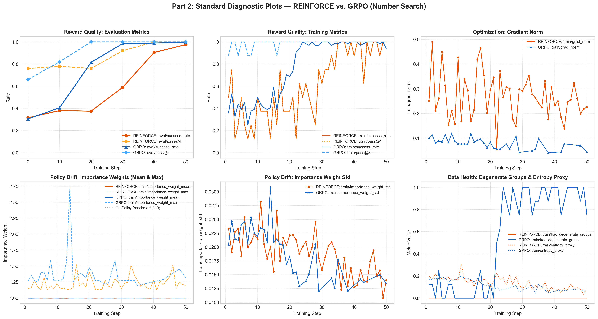
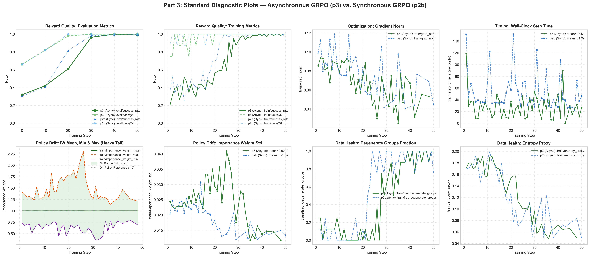
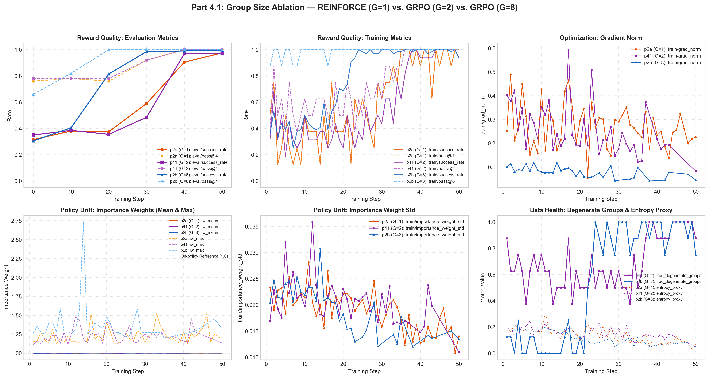
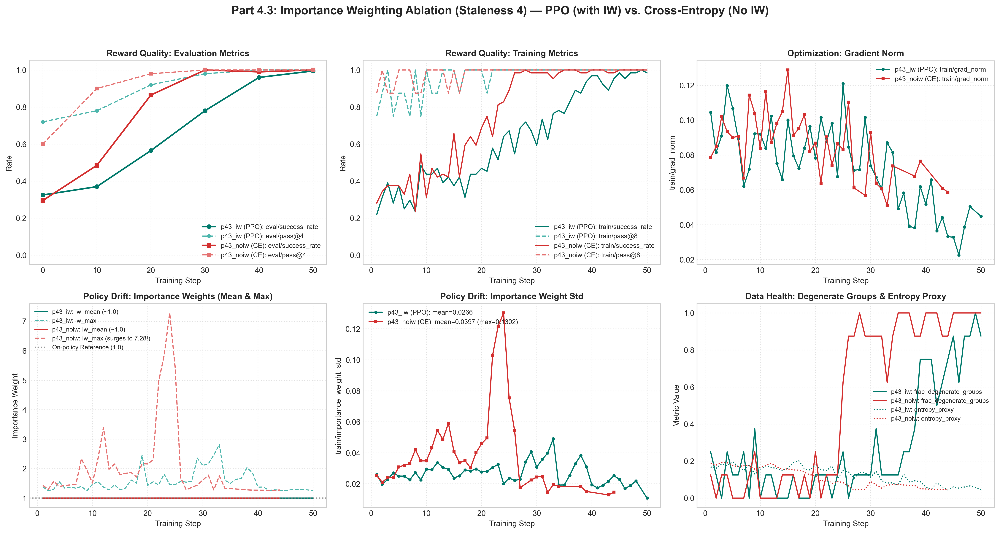

# 11-768 Assignment 3: Reinforcement Learning for LLM Agents

## Part 2: Synchronous REINFORCE and GRPO

### Standard Diagnostic Plots

Below are the standard diagnostic plots comparing the synchronous REINFORCE (`p2a_number_search_reinforce`) and GRPO (`p2b_number_search_grpo`) runs on the Number Search environment across 50 training steps.

### Key Milestones & Quantitative Summary

| Step | REINFORCE `eval/success_rate` | REINFORCE `eval/pass@4` | GRPO `eval/success_rate` | GRPO `eval/pass@4` |
|:---:|:---:|:---:|:---:|:---:|
| **0** (Baseline) | 0.315 | 0.760 | 0.305 | 0.660 |
| **10** | 0.380 | 0.780 | 0.405 | 0.820 |
| **20** | 0.375 | 0.760 | **0.815** | **1.000** |
| **30** | 0.590 | 0.920 | **0.985** | **1.000** |
| **40** | 0.905 | 1.000 | 0.990 | 1.000 |
| **50** | 0.975 | 1.000 | 0.995 | 1.000 |

### Comparison of REINFORCE and GRPO (Learning Speed & Dynamics)

GRPO exhibits substantially faster and more stable learning than REINFORCE, rapidly driving evaluation success rate from a step-0 baseline of 30.5% to 81.5% by step 20 and 98.5% by step 30, whereas REINFORCE remains stagnant under 40% through step 20 and only surpasses 90% at step 40. This pronounced difference is expected because GRPO subtracts the group-mean reward baseline ($A_i = r_i - \bar{r}$) across $G=8$ rollouts per task, which neutralizes task-difficulty confounding and isolates whether an action trajectory performed better or worse than the policy's typical attempt. In contrast, REINFORCE relies on uncentered binary rewards from single rollouts ($G=1$), producing severe gradient variance—as demonstrated by REINFORCE's volatile gradient norm peaking near 0.49 compared to GRPO's well-controlled gradient norm below 0.12—which significantly retards parameter updates under sparse feedback. Moreover, sampling 8 rollouts per task provides a denser exploration signal per batch, enabling GRPO to solve nearly all tasks by step 25, after which unanimous successes cause `train/frac_degenerate_groups` to rise and trigger degenerate group skips.

### Diagnostic Analysis

1. **Reward Quality**: Both algorithms ultimately master the task within 50 steps, rising well above their initial baselines (~31%). However, GRPO achieves near-perfect `eval/pass@4` (1.0) and >80% single-attempt accuracy by step 20, whereas REINFORCE requires approximately 40 steps to attain similar performance.
2. **Optimization**: GRPO maintains a lower and substantially less erratic `train/grad_norm` throughout training, demonstrating the variance-reduction efficacy of the group-relative baseline. REINFORCE experiences large fluctuations due to noisy episodic gradients.
3. **Policy Drift**: The importance weights `train/importance_weight_mean` remain strictly centered at 1.0 across all steps for both runs, confirming that the synchronous update loop properly synchronizes rollout sampling and learner versions on-policy.
4. **Data Health**: REINFORCE maintains `train/frac_degenerate_groups` at 0.0 because single-rollout groups cannot be degenerate. In GRPO, `train/frac_degenerate_groups` rises sharply after step 22 as the policy approaches 100% success rate, causing entire groups of 8 rollouts to succeed simultaneously ($A_i = 0$), properly skipping redundant updates. Both policies display a consistent drop in `train/entropy_proxy` from ~0.20 to <0.07, indicating policy sharpening and convergence.

---

## Part 3: Asynchronous GRPO

### Standard Diagnostic Plots

The standard diagnostic plots below evaluate the asynchronous GRPO implementation (`p3_number_search_async`) side-by-side with the synchronous GRPO baseline (`p2b_number_search_grpo`). Both configurations train on Number Search for 50 steps with 8 groups of 8 rollouts per batch ($G=8$), but `p3` employs 8 parallel rollout workers and allows policy staleness up to 2.

### Key Milestones & Quantitative Summary

| Step | `p2b` (Sync) `eval/success_rate` | `p2b` (Sync) `eval/pass@4` | `p3` (Async) `eval/success_rate` | `p3` (Async) `eval/pass@4` |
|:---:|:---:|:---:|:---:|:---:|
| **0** (Baseline) | 0.305 | 0.660 | 0.320 | 0.660 |
| **10** | 0.405 | 0.820 | 0.420 | 0.820 |
| **20** | **0.815** | **1.000** | 0.610 | **0.980** |
| **30** | **0.985** | **1.000** | **0.965** | **1.000** |
| **40** | 0.990 | 1.000 | **1.000** | **1.000** |
| **50** | 0.995 | 1.000 | **0.990** | **1.000** |

At the completion of the 50-step run, the trainer accounting statistics recorded in the final record of `runs/p3_number_search_async.jsonl` were:
- `summary/train_steps`: **50**
- `summary/groups_consumed`: **400**
- `summary/groups_dropped_stale`: **80**

### Policy Drift & Importance-Weight Distribution (The Heavy Tail)

In asynchronous training, rollouts are produced with policies up to `max_staleness=2` versions older than the current learner policy. Examining the importance weight statistics reveals crucial structural dynamics:

- **Mean**: Across all 50 steps, `train/importance_weight_mean` remains remarkably close to 1.0 (mean across training: **0.9999**, min: **0.9993**, max: **1.0004**).
- **Minimum & Maximum**: Despite the stable mean, `train/importance_weight_min` drops as low as **0.3557** (averaging **0.6215**), while `train/importance_weight_max` surges to **2.3134** (averaging **1.4856**).
- **Standard Deviation**: The importance weight standard deviation `train/importance_weight_std` in `p3` averages **0.0242** (peaking above **0.0409** during the rapid learning phase around steps 15–25), noticeably higher than synchronous `p2b`'s average of **0.0189**.

**Analysis**: This empirical divergence clearly illustrates why a mean near 1.0 is deceptive: the mathematical expectation $\mathbb{E}_{\pi_{\text{old}}}[\rho] = 1$ is preserved in aggregate, but masks a significant asymmetric heavy right tail in individual token likelihood ratios ($\rho_{\max} > 2.3$). Because of policy staleness, individual action tokens sampled under $\pi_{\theta-1}$ or $\pi_{\theta-2}$ become considerably more probable under the updated learner policy $\pi_\theta$. This heavy tail underscores why clipped PPO surrogate objectives (clipping $\rho$ to $[1-\epsilon, 1+\epsilon]$) are indispensable in asynchronous RL: clipping prevents anomalous stale outlier tokens from exerting outsized gradient forces that would destabilize policy updates.

### Wall-Clock Time Comparison and Speedup

Asynchronous GRPO significantly mitigates GPU idle time by overlapping parallel rollout workers with learner updates via a bounded producer-consumer queue:

| Metric | Synchronous GRPO (`p2b`) | Asynchronous GRPO (`p3`) | Speedup / Reduction |
|---|:---:|:---:|:---:|
| **Mean Step Time (`train/step_time_s`)** | **51.94 s** | **27.50 s** | **1.89x speedup** (47.1% reduction) |
| **Median Step Time (`train/step_time_s`)** | **39.38 s** | **24.34 s** | **1.62x speedup** (38.2% reduction) |
| **Total Wall-Clock Time (Step 1 to 50)** | **2445.35 s** (40.76 min) | **1256.34 s** (20.94 min) | **1.95x speedup** (48.6% reduction) |

**Analysis**: In synchronous training (`p2b`), the learner sits completely idle for ~26.6 seconds per step while awaiting sequential rollout collection (`train/learner_wait_s` averages 33.7s). In asynchronous training (`p3`), 8 parallel rollout workers pre-generate groups into the queue, so the learner can consume fresh batches nearly continuously. This producer-consumer pipeline cuts total wall-clock training time virtually in half from **40.8 minutes down to 20.9 minutes** (**1.95x overall speedup**), achieving identical terminal performance (99–100% success rate) in nearly half the training wall-clock time.

### Transcript Analysis Across Training

To analyze how the agent's behavioral policy evolves over time, we inspect three training rollouts from the saved transcripts at steps 5, 25, and 50:

| Stage | Step | Task ID | Policy Version | Target & Range | Reward & Steps Taken |
|:---:|:---:|:---:|:---:|:---:|:---:|
| **Early** | `5` | `number_search.train.64` | `4` | Target: `131`, Range: `[86, 153]` | Reward: **0.0** (7 steps, failed) |
| **Middle** | `25` | `number_search.train.252` | `23` | Target: `677`, Range: `[360, 910]` | Reward: **1.0** (8 steps, success) |
| **Late** | `50` | `number_search.train.471` | `41` | Target: `757`, Range: `[319, 924]` | Reward: **1.0** (9 steps, success) |

#### Concrete Behavioral Evolutions:

1. **Elimination of Boundary Violations in Favor of Strict Binary Search (Bisection)**:
   - *Early (`step 5`, rollout 4)*: The agent exhibits disordered guessing and fails to incorporate environmental feedback into valid search intervals. After receiving `"120 is too low"` and `"138 is too high"` (restricting the valid range to $[121, 137]$), its subsequent guess is `116`—blatantly violating the known lower bound. Similarly, after learning `"127 is too low"` and `"134 is too high"`, it guesses `125`. Other early rollouts (e.g. `rollout 1`) even repeat the identical guess `120` consecutively.
   - *Middle & Late (`step 25` & `step 50`)*: The policy completely abandons invalid backtracking and adopts strict binary bisection. In each turn, it precisely tracks the updated lower and upper bounds and computes arithmetic midpoints (e.g., `(360+910)/2 = 635`, `(636+910)/2 = 773`, `(636+772)/2 = 704` in rollout 252; `(319+924)/2 = 621.5 -> 621` in rollout 471), systematically halving the search space on every turn.

2. **Emergence of Test-Time Chain-of-Thought Scratchpads and Terminal Deductive Shortcuts**:
   - *Early (`step 5`)*: The agent generates zero scratchpad thoughts before acting; its completions immediately emit bare tool calls like `<tool>guess(120)</tool>`. Without intermediate reasoning tokens, arithmetic computation is noisy and ungrounded.
   - *Middle & Late (`step 25` & `step 50`)*: The agent learns to construct explicit scratchpad reasoning before emitting tool calls. It explicitly verbalizes the last environment feedback, updates the active search boundaries, and calculates the midpoint:
     > `"Since 621 is too low, the number is between 622 and 924. New midpoint = (622 + 924) / 2 = 773. <tool>guess(773)</tool>"`
   - *Terminal Deduction in Late Rollouts (`step 50`)*: By step 50, the policy exhibits higher-order deduction at search termination. In turn 8 of task `471`, when the valid interval collapses to $[757, 757]$ after `"756 is too low"`, the agent immediately reasons:
     > `"Since 756 is too low, the number must be 757 (only number left between 755 and 757). <tool>guess(757)</tool>"`
     It deduces the solution logically rather than performing redundant bisection arithmetic.

---

## Part 4: Ablations on Number Search

### 4.1 Group Size Ablation: $G=1$ (REINFORCE) vs. $G=2$ (GRPO) vs. $G=8$ (GRPO)

#### Standard Diagnostic Plots
Below are the standard diagnostic plots comparing group sizes across REINFORCE (`p2a`, $G=1$), GRPO with $G=2$ (`p41`), and standard GRPO with $G=8$ (`p2b`).

#### Quantitative Group-Size Comparison

| Metric / Run | REINFORCE (`p2a`, $G=1$) | GRPO (`p41`, $G=2$) | GRPO (`p2b`, $G=8$) |
|---|:---:|:---:|:---:|
| **Baseline `eval/success_rate` (Step 0)** | 0.315 | 0.350 | 0.305 |
| **Step 20 `eval/success_rate`** | 0.375 | 0.355 | **0.815** |
| **Step 30 `eval/success_rate`** | 0.590 | 0.485 | **0.985** |
| **Final `eval/success_rate` (Step 50)** | 0.975 | 0.970 | **0.995** |
| **Early `train/frac_degenerate_groups` (Steps 1–15)** | **N/A** | **0.617** | **0.050** |
| **Mean Useful Sequences Per Step** | 8.0 | 5.0 | **29.12** |
| **Mean Gradient Norm (`train/grad_norm`)** | 0.274 | 0.246 | **0.071** |

#### Analysis: Advantage Variance and Sequence Utility
Comparing group sizes reveals how group baseline dimensionality governs gradient variance and data efficiency. In GRPO with $G=2$, the advantage for rollout $i \in \{1, 2\}$ is $A_i = r_i - \frac{r_1 + r_2}{2} = \pm \frac{r_1 - r_2}{2}$. When the policy has an intermediate success rate $p \approx 0.35$, the probability that both rollouts in a pair yield the identical outcome (either both succeed or both fail) is $p^2 + (1-p)^2 \approx 0.545$. Consequently, during early training (steps 1–15), an overwhelming **61.7% of groups in `p41` are degenerate** (`train/frac_degenerate_groups` = 0.617) and provide exactly zero learning signal. This starves the learner of data, yielding on average only **5.0 useful training sequences per step** out of 16 rollouts collected, and resulting in high advantage variance that keeps evaluation success rate stagnant at ~35.5% through step 20 (comparable in pace to REINFORCE). In contrast, with $G=8$ (`p2b`), the probability of all 8 rollouts obtaining identical rewards is negligible early on ($p^8 + (1-p)^8 \approx 0.05$), so `train/frac_degenerate_groups` averages only **0.050** (5%), feeding the optimizer **29.12 useful sequences per step** and computing a far more stable baseline that drives success to **81.5% by step 20**. Note that for REINFORCE (`p2a`), the degenerate fraction is strictly **N/A**: because REINFORCE uses no group baseline ($A=r$), its logged degenerate fraction of 0 is an artifact rather than a meaningful measure of sequence filtering. Furthermore, `p2a` differs from the GRPO runs not only in group size but also in its raw advantage rule ($A=r$) and loss formulation (`importance_sampling` without clipping vs. `ppo`), meaning differences between `p2a` and `p41` encompass both baseline structure and objective design.

---

### 4.2 Synchronous vs. Asynchronous Training

#### Standard Diagnostic Plots
The standard diagnostic plots contrasting synchronous GRPO (`p2b`) with asynchronous GRPO (`p3`) are displayed in [Part 3](#part-3-asynchronous-grpo) ([`assets/p3_diagnostic_plots.png`](assets/p3_diagnostic_plots.png)).

#### Wall-Clock & Performance Comparison

| Run Configuration | Final `eval/success_rate` | Final `eval/pass@4` | Mean Step Time (`train/step_time_s`) | Total Wall-Clock (50 steps) | Throughput Speedup |
|---|:---:|:---:|:---:|:---:|:---:|
| **Synchronous GRPO (`p2b`)** | **0.995** | **1.000** | 51.94 s | 2445.35 s (40.76 min) | 1.00x (Baseline) |
| **Asynchronous GRPO (`p3`)** | **0.990** | **1.000** | 27.50 s | 1256.34 s (20.94 min) | **1.95x Speedup** |

#### Analysis: Speedup Origin, Stale Data, and Sample Quality
The 1.95x wall-clock speedup achieved by asynchronous training stems entirely from pipelined producer-consumer overlap: whereas the synchronous trainer forces the GPU learner to wait idly for ~26.6 seconds per step while rollouts are collected sequentially (`train/learner_wait_s` averages 33.67s), the asynchronous architecture maintains 8 continuous rollout workers generating trajectories into a bounded queue, enabling the learner to pull ready batches with near-zero latency. Crucially, training on stale data (rollouts generated under policies up to `max_staleness=2` versions old) incurred **no penalty in sample quality or final policy performance**: `p3` converged to a final evaluation success rate of **99.0%** (and 100% `eval/pass@4`), matching `p2b`'s **99.5%**. This sample quality retention is corroborated by the importance-weight statistics, where the mean importance weight across all 50 steps stayed at **0.9999** ($\approx 1.0$) and PPO clipping neutralized the occasional heavy-tail ratio drift ($\rho_{\max} \approx 2.31$). Furthermore, the queue's staleness guard successfully protected data freshness: the final record of `runs/p3_number_search_async.jsonl` logs `summary/groups_consumed: 400` and `summary/groups_dropped_stale: 80`, demonstrating that discarding the 16.7% of groups that exceeded staleness bounds prevented degraded off-policy data from polluting optimizer gradients without starving the learner.

---

### 4.3 Importance Weighting under Higher Staleness ($\text{max\_staleness}=4$)

#### Standard Diagnostic Plots
Below are the standard diagnostic plots comparing the importance-weighted PPO run (`p43_iw`) with the unweighted cross-entropy run (`p43_noiw`) under increased policy staleness (`max_staleness=4`).

#### Quantitative Drift & Optimization Comparison

| Metric | `p43_iw` (PPO with Importance Weighting) | `p43_noiw` (Advantage-Weighted Cross-Entropy) |
|---|:---:|:---:|
| **Final `eval/success_rate` (Step 50)** | **0.995** | **1.000** |
| **Mean Importance Weight (`train/importance_weight_mean`)** | 0.9999 (range: [0.9992, 1.0004]) | 1.0000 (range: [0.9994, 1.0010]) |
| **Maximum Importance Weight (`train/importance_weight_max`)** | **2.8201** (avg: 1.5609) | **7.2803** (avg: 2.1700) |
| **Minimum Importance Weight (`train/importance_weight_min`)** | 0.3142 (avg: 0.5615) | **0.0041** (avg: 0.4701) |
| **Peak IW Standard Deviation (`train/importance_weight_std`)** | **0.0490** (avg: 0.0266) | **0.1302** (avg: 0.0397) |
| **Mean Gradient Norm (`train/grad_norm`)** | **0.0732** | 0.0847 |
| **Stale Groups Dropped (`summary/groups_dropped_stale`)** | 0 | 0 |

#### Analysis: Policy Drift and the Role of Importance Weighting
Under higher permitted staleness ($\text{max\_staleness}=4$), rollout workers produce episodes under policies lagging by up to 4 gradient updates, providing a severe stress test for off-policy corrections. When importance weighting is eliminated (`p43_noiw`), the optimizer updates parameters via advantage-weighted log-likelihood ($-\sum A_j \log \pi_\theta$), treating off-policy trajectories as though they were strictly on-policy. As a direct consequence, policy drift expands unchecked: the maximum importance ratio surges to **7.2803** (over 2.5x higher than in `p43_iw`), the minimum ratio collapses to **0.0041**, and `train/importance_weight_std` spikes to **0.1302** (a 2.66x increase over `p43_iw`'s peak of 0.0490). In contrast, `p43_iw` applies the clipped PPO surrogate objective ($-\min(\rho A, \text{clip}(\rho, 1-\epsilon, 1+\epsilon) A)$), which strictly censors gradient contributions from tokens whose probability ratios deviate beyond $[0.8, 1.2]$. This keeps `train/importance_weight_std` low and controlled (averaging 0.0266) and maintains a calmer optimization landscape (`train/grad_norm` averages 0.0732). While both runs eventually master the narrow discrete action space of Number Search (with `p43_noiw` even climbing faster initially due to large, unclipped policy steps), the dramatic distortion of likelihood ratios in `p43_noiw` exposes the fundamental risk of omitting importance corrections: in complex, non-deterministic, or long-horizon domains, unclipped drift of this magnitude causes premature policy entropy collapse and catastrophic divergence.

